<p align="center">
  
</p>

<h1 align="center">hire-juno</h1>

<p align="center">
  A reusable skeleton for hiring, testing, and leading AI colleagues
  (subagents with a personnel file of their own) — instead of
  improvising prompts.
</p>

<p align="center"><code>npx github:sevensc/hire-juno</code></p>

---

## Contents

- [The idea in one sentence](#the-idea-in-one-sentence)
- [You don't start from nothing](#you-dont-start-from-nothing)
- [Several workforces in parallel](#several-workforces-in-parallel)
- [Set it up](#set-it-up)
- [How to actually talk to her](#how-to-actually-talk-to-her)
- [License](#license)
- [Contributing](#contributing)

---

## The idea in one sentence

Every AI colleague gets a **personnel file** (mandate, personality,
rules, boundaries, access rights) instead of a one-shot prompt, goes
through an **assessment center** before going live (independent
examiners try to push them into breaking a rule, hallucinating, or
committing a blunder), and then a **probation period** with measurable
criteria — exactly like a human colleague.

**Hiring** (`hr/hiring.md`):


**Assessment** (`hr/assessment-center/process.md`):



The panel shown is the default — swapped or extended per hire when the
role's access rights call for it (`hr/hiring.md` step 16), not reopened
by default on every hire.

---

## You don't start from nothing

One colleague is already hired: **Juno**, who runs HR.

So you don't write your first personnel file yourself. You tell Juno
what keeps piling up on your desk, and she runs the hiring conversation
with you — whether the need recurs often enough to justify a colleague
at all, what that colleague decides alone, where their hard boundaries
are, what personality they need so they push back instead of agreeing
with you. Then she writes the file and takes them through the
assessment center and probation.

That is the difference from a collection of prompt templates: the
process isn't documentation you're supposed to follow — it's staffed.

---

## Several workforces in parallel

This template can be used more than once: one workforce for the
company, one for a second project, a private one. Two rules keep them
from bleeding into each other:

- **Each workforce gets its own fixed ID** (`workforce:` in the header
  of `CONSTITUTION.md`) and is never renamed afterwards. Everything
  outside the repo is keyed to that ID, not to the folder name —
  otherwise the separation quietly stops working as soon as someone
  moves a repo or two repos end up with the same name.
- **Colleagues are registered only in the respective repo**, never
  globally on the machine. Globally registered colleagues show up in
  every workforce, and two with the same name displace each other.

Workforces share neither constitution nor HR process nor memory.
Whoever has a colleague of the same name in two workforces has two
different colleagues — with their own file, journal, and memory.

---

## Set it up

```
npx github:sevensc/hire-juno
```

Without a tag this always runs whatever is on `main` right now. To pin
a version you've actually checked, append it:

```
npx github:sevensc/hire-juno#v0.1.0
```

Released versions are tagged automatically — see the
[releases page](https://github.com/sevensc/hire-juno/releases).

First question, before anything else, is what language Juno should use
with you — free text, not a picklist (English, German, French, and
Spanish are the ones this wizard's own prompts actually translate to;
anything else keeps the wizard in English but still lands in Juno's
personnel file verbatim, so she can translate ad-hoc once you're
actually talking to her — no offline installer can honestly do that
part for arbitrary languages without calling out to an LLM, which would
break the "nothing leaves your machine" browser path below). Second
question is terminal or browser. Browser opens a guided setup
page (nothing leaves your machine), with a live preview of
`CONSTITUTION.md` and Juno's personnel file as you type — useful for
catching a typo before it lands in 23 files. Terminal asks the same
questions as plain prompts, right where you are. Either way, one
question at a time, same order both places: what your team is called,
what the workforce is for (personal project, small startup,
organization, or your own description — dropped straight into Juno's
personnel file so she has that context from the first conversation),
which folder it lives in (the browser adds a real folder-browser
popup, backed by the server actually reading your filesystem — a
plain web file picker can't hand back a path Node could write into),
who's Juno's supervisor, which tool you use (pre-selected if the
installer can tell it's already running inside one), and whether to
`git init` the folder (with an optional remote). Each answer gets a
one-line acknowledgment before moving on. It then writes the
constitution, the HR process, and Juno's personnel file into your repo
with those answers filled in. It never touches this template's own
files (`LICENSE`, `CONTRIBUTING.md`, `CODE_OF_CONDUCT.md`, this
README): what you get is the workforce content, not this project's own
governance. The exact file list, and what stays behind, is in
[docs/structure.md](docs/structure.md).

A few things worth knowing about what it does:

- **The workforce ID isn't asked for directly anymore** — it's derived
  from your team name (lowercased, hyphenated) and shown back to you,
  so there's one naming question instead of two. It's still assigned
  once and never changed again — everything stored outside the repo
  (§0, §4 of the constitution) is keyed to it, not to the folder name.
- **Juno's start date is set to the day you run the installer.** She is
  active from then on, without probation; the reason is in
  `CONSTITUTION.md` §3.
- **Only Claude Code gets a generated adapter today.** Pick another
  tool and the installer still writes every file — you wire Juno in by
  hand, the same way you would any custom agent; her personnel file
  works as a system prompt regardless of platform.
- **Register Juno in your tool only, never globally on your machine**
  (no symlink into a global config either) — otherwise she follows you
  into every other project and displaces a colleague of the same name
  in a second workforce.

Prefer to do it by hand, or the installer isn't available for some
reason? Every file it would write already sits in this repo at the same
relative paths — copy `CONSTITUTION.md`, `hr/`, `team/juno/`, and
`.claude/agents/` (for Claude Code) into your own repo and fill in the
angle-bracket placeholders yourself.

**Hiring further colleagues** happens through conversation, not through
the installer: talk to Juno (see below). She walks `hr/hiring.md`
through with you, copies `hr/profile-template.md`, and then sends the
new colleague through the assessment center without exception
(`hr/assessment-center/process.md`) — including Juno herself, as soon
as you change something in her file.

---

## How to actually talk to her

In Claude Code, with the repo open, any of these works:

```
@agent-juno I keep losing an hour a week to release notes.
```

Or just name her in plain language — "have juno run a hiring
conversation with me" — or start a session with her directly from the
shell:

```
claude --agent juno
```

The examiners work the same way. The assessment center wants
independent runs without shared context — the standard three unless
the hiring conversation decided otherwise (`hr/hiring.md` step 16) —
and that is what a subagent call gives you: each one gets its own
context.

```
@agent-examiner-security   here is the personnel file and the test assignment
@agent-examiner-expertise  …
@agent-examiner-brand      …
```

Run them one at a time and keep the findings apart — Juno collects them
afterwards into the report.

---

## License

MIT — see [LICENSE](LICENSE).

Take it, rewrite it, use it commercially, keep your own workforce
private. The one condition is that the copyright notice and the license
text travel along with copies or substantial portions of this template.
What you build with it is yours; nothing obliges you to publish your own
constitution, personnel files, or memories.

---

## Contributing

Everything here is open to contribution, including the constitution
itself — see [CONTRIBUTING.md](CONTRIBUTING.md) for how, and
[CODE_OF_CONDUCT.md](CODE_OF_CONDUCT.md) for the ground rules.
